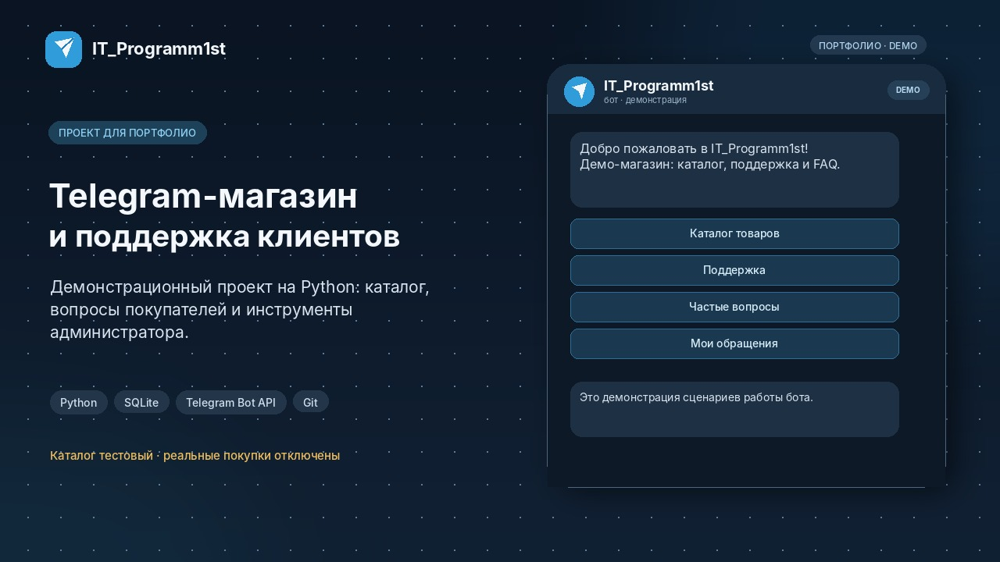

# 🤖 IT_Programm1st

### Telegram Store & Customer Support Demo

Демонстрационный проект Telegram-магазина, разработанный на Python.

## 🎬 Демонстрация проекта

[▶️ Посмотреть видео проекта (MP4)](IT_Programm1st_demo_video.mp4)

## ⚙️ Основные возможности

- 🛍 Каталог товаров
- 💬 Обращения покупателей
- 🤖 FAQ и автоматические ответы
- 🔔 Уведомления администратора
- 🗄 Сохранение данных в SQLite
- 👨‍💻 Управление через административные команды

## 🛠 Используемые технологии

- Python
- python-telegram-bot
- SQLite
- Git

## 👨‍💻 Об авторе

Начинающий Python-разработчик.

Интересуюсь созданием Telegram-ботов,
автоматизацией и разработкой инструментов для бизнеса.

Мой проект: IT_Programm1st

## 📌 Примечание

Видеоролик представляет собой анимированную
демонстрацию интерфейса, а не реальную запись
работающего бота. Покупки и платежи в этой
демонстрационной версии отключены.
